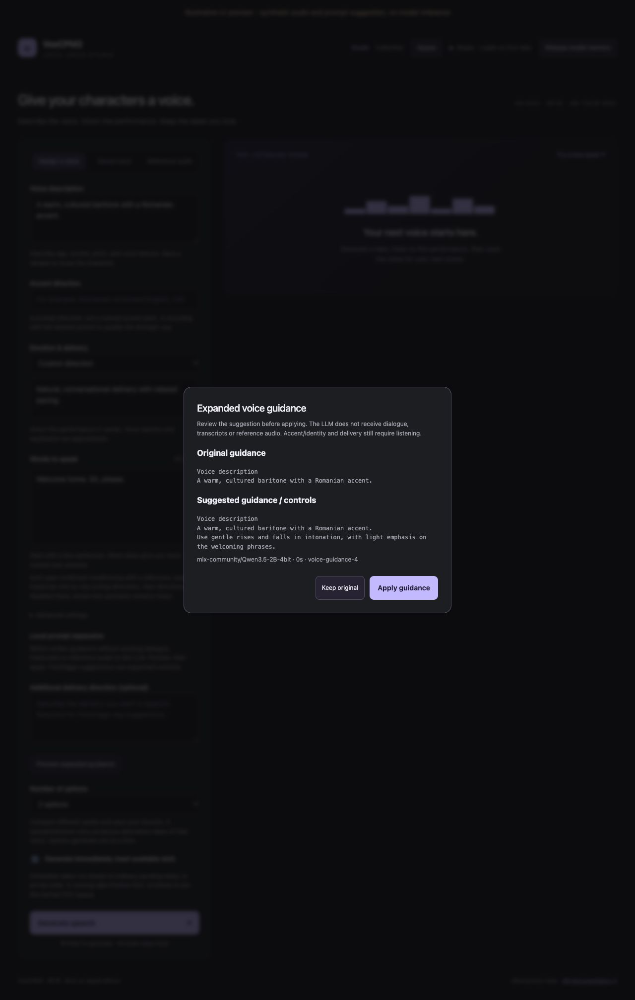

# Local Voice Studio

Serving project: **VoiceGen-Service**. Source: [ashwinmahesh/VoiceGen-Service](https://github.com/ashwinmahesh/VoiceGen-Service). The product UI and model IDs retain their existing names.

One local speech studio with a shared UI, voice library, durable job API and startup-selected model. Existing VoxCPM2/Qwen behavior is retained. Chatterbox, IndexTTS 2.5, MOSS VoiceGenerator, Fish S2 Pro and Higgs TTS 3 use adapters inside the same project.

Read [BACKENDS.md](BACKENDS.md) for the backend matrix, Python environments, controls, exact licenses, model/codec storage, real-smoke interpretation and integration instructions. `make setup MODEL=...` installs one selected runtime and pinned assets; `make serve MODEL=... PORT=8017` starts it on an unused port. `server.py --backend ...` also selects at startup. Omitting MODEL selects **Higgs TTS 3**, the shared default recorded in `service_defaults.json`. Explicit model choices retain their existing environments and SSD asset paths. Some examples below explicitly use Vox/MLX controls. Read [API.md](API.md) and live `/api/capabilities` for the common protocol and model-specific validation.

## UI preview

Full-page screenshots of the separate Generate and Collection pages, plus the page with Queue open. These use synthetic demo audio, illustrative data and example timings; no private recordings or catalogs are shown.

### Generate a line

Choose or upload a saved voice, enter the line, and choose **1–5 options** (default **2**). Each option has its own player, download and **Save voice** action. Designed voices explore contrasting descriptions and seeds; saved/reference voices produce alternative takes of the selected voice. The Prompt expansion switch defaults on when the backend serves the LLM.


### Collection

Search History and Voice library, edit names/descriptions/tags, or use **Upload voice** to add your own recording directly.


### Queue

Open **Queue** from the header on either page. The centered modal uses 80% of the screen height, with entries scrolling between the filters and pagination. It lists jobs with status filters, paging, pending removal/clear and failed-job retry. Each entry's action buttons are stacked vertically on the right.


## Setup and storage

Tested on this Mac: Apple M6, 24 GB unified memory, macOS, Python 3.14, MLX 0.32.4, MLX Audio 0.6.1. `requirements.lock.txt` pins all installed Python dependencies. Use an Apple Silicon macOS interpreter for this lockfile. Server source, UI, documentation, the Python virtual environment and the SQLite queue (`state/queue.sqlite3`) live in `~/Documents/models/<service-name>`. Model weights, extension vectors, caches, temporary files, recordings, outputs, catalog files and legacy JSON job records stay in `/Volumes/ASH-SSD/models/<service-name>`. No model weights were copied to internal storage. Python's base Homebrew framework remains at its installed location.

On this Mac the serving project is `~/Documents/models/VoiceGen-Service` for every backend, including Qwen. Shared SSD data remains at `/Volumes/ASH-SSD/models/VoxCPM2`; Qwen weights and extensions are reused from `/Volumes/ASH-SSD/models/Qwen3-TTS`. The separate Qwen serving project has been retired. Its saved voices, references, history indexes and legacy job/retry records are consolidated into the shared library, while historical audio remains at its existing SSD paths. Preserve these data folders: deleting the old serving project does not delete model or audio storage. Ignored `storage.json` selects the shared `data_dir`, backend asset mappings and SSD `gpu_lock_file`; explicit environment/Make overrides take precedence. A fresh clone or ZIP works with ordinary `make setup`: on first terminal use it asks for a model/data folder. Press Enter to keep it inside the project, or enter another absolute folder to create data symlinks. Retries remember that choice. No ASH-SSD path or manual configuration file is required. For scripts or AI tools use `make setup NONINTERACTIVE=1` to select the default without a question, or supply an explicit DATA_DIR to select external storage. With no terminal, setup also uses the default without blocking. To use external storage, run `make setup DATA_DIR=/Volumes/YourDrive/models/service-name`; setup validates the mount, creates data links, and saves the choice in ignored storage.json so later `make start` uses it automatically. `make configure-storage DATA_DIR=...` configures storage without installing or downloading. Existing local data or links to another destination are preserved and reported for explicit migration. Convenience data-directory links expose existing SSD files from the project; preserve their targets. The venv itself is local. A disconnected linked volume fails before model downloads; there is no fallback download to the internal drive.

Prerequisites: Apple Silicon macOS, Git and Make. Higgs/native backends use Python 3.11; MLX backends and the default-enabled prompt LLM use Python 3.14. See [BACKENDS.md](BACKENDS.md) for environment selection. Install the needed interpreter(s), for example `brew install python@3.11 python@3.14`, or pass `BOOTSTRAP_PYTHON=/absolute/path/to/python`. The installed native interpreter is reused on this Mac.

```sh
cd /absolute/path/to/project
make setup
make start
make open
make health
```

In a terminal, plain `make setup` first lists all seven models: VoxCPM2, Qwen3-TTS, Chatterbox Original, IndexTTS 2.5, MOSS VoiceGenerator, Fish S2 Pro and Higgs TTS 3. Enter a listed number or model ID; **blank/Enter selects Higgs TTS 3**, marked as the default. Setup installs the selected speech backend plus the shared optional prompt LLM assets/runtime; serving enables the LLM by default, with `NO_LLM=1` as the opt-out. `make setup MODEL=higgs` selects directly without the menu. `NONINTERACTIVE=1` or non-terminal input uses the explicit model or the default without waiting for input. The model/data-folder prompt is separate and remembers its saved location.

`make setup-env` installs only the runtime. `make download` resumes pinned required files and verifies sizes, JSON, SHA256 for LFS assets and Git blob SHA1 for small files. `model_specs.json` records repository revisions, expected files, byte counts and upstream hashes. A complete checksum manifest is written only after successful verification; corrupted required files are removed on a failed verification so rerunning download repairs them. `make verify` checks all hashes again. Runtime readiness compares the manifest, required file sizes and modification times and parses JSON, without repeatedly hashing gigabytes on every health request. Serving is offline and never downloads weights implicitly.

Check that the SSD is mounted before setup/start; paths under `/Volumes` are validated before directories are created. Moving DATA_DIR does not migrate existing weights or catalogs: explicitly copy the intended data or run download in that data root. Keep model weights under DATA_DIR/weights. Leave extra space for the Python environment, download staging, allocator/context/decoder memory and generated audio, beyond the weight bytes.

```sh
# An explicit DATA_DIR skips the first-use question. All overrides flow through setup, serve, health and smoke:
make setup BOOTSTRAP_PYTHON=/path/to/python3.14 VENV=/absolute/local/venv DATA_DIR=/absolute/ssd/data
make start VENV=/absolute/local/venv DATA_DIR=/absolute/ssd/data OUTPUT_DIR=/absolute/ssd/takes PORT=8014
make health VENV=/absolute/local/venv DATA_DIR=/absolute/ssd/data PORT=8014
```

`clean_env.py` removes only validated AppleDouble metadata sidecars from the environment after pip installation. On exFAT, macOS `._*.py` files can otherwise break Transformers module discovery. The downloader and loader also remove validated AppleDouble sidecars from weight folders, because Qwen scans all decoder safetensors files. If that error returns, run `make setup-env` or `VENV/bin/python clean_env.py /absolute/path/to/venv`. Do not use arbitrary recursive deletion commands on recordings or weights.

## Run and stop

`make serve` runs the **generator** in the foreground. It serves the entire studio UI, Collection, Queue modal and existing generation API on **http://localhost:5743/**. It first ensures the independent queue CRUD service is running on **http://localhost:55205/**, reusing a matching instance or starting one in its own session. Ctrl-C finishes active generation, stops the generator and leaves the queue service and pending work intact. The queue service has no generation UI, model selection, model validation, LLM or inference imports; it only stores and reads job payloads in SQLite.

```sh
make queue                 # Queue CRUD alone, foreground; no model assets needed
make serve MODEL=voxcpm2    # Ensure queue exists, then generator + studio UI
make stop MODEL=voxcpm2     # Stop a verified idle managed generator only
make stop-queue            # Stop the separate queue API; retain SQLite/jobs
make queue-status
```

Use `QUEUE_PORT=<number>` to override the saved queue port independently of generator `PORT`. `make setup-queue` installs only the pinned HTTP dependencies in `.venv-queue`, without models; normal `make setup` includes it. Existing installations can use their current Python environment without reinstalling. `QUEUE_PYTHON=/absolute/path/to/python` selects an installed queue runtime; the dedicated environment is preferred when present. The queue can run with the model SSD disconnected. Generator inference still requires its configured media/assets volume.

`make start` explicitly starts a managed background generator, reuses a matching instance, and records its PID/log in project-local `state/`. `make stop` checks identity, project/data root, command, cwd and listening PID before stopping a managed idle generator; it leaves the queue API running. `make stop-queue` separately verifies the queue role, project, database, command, cwd and PID. Both refuse unrelated listeners. `make status` displays generator state; `make health` fails for offline/mismatched/error/incomplete generators. No login item or automatic launch service is installed. `Start Voice Studio.command` runs the explicit background start/open commands.

For this installation, stop agent-started generators, queue APIs and temporary UI previews after tests/maintenance. The default final state is stopped; preserve pre-existing user-started services and do not automatically restore Vox or another backend unless explicitly requested. Start the service manually when needed.

Plain `make serve` in a terminal shows a numbered list of **already set-up models**, with readable names, model IDs and a marked default. Models not set up or currently unavailable appear separately without numbers, each with its `make setup MODEL=<id>` command; they cannot be selected. Enter a ready model's number/ID, or leave it blank to use Higgs TTS 3 when available. The list checks verified local assets and the selected model's environment/runtime without loading weights. If Higgs is not set up, the first ready model is clearly marked as this menu's default; if none are ready, serving lists the unavailable models and stops with setup/remount instructions. `make serve MODEL=qwen3` skips the menu and validates that model. Noninteractive serving keeps the explicit or configured default and fails clearly when it is not ready; it never silently switches to another model or downloads weights.

Restricted models print a prominent **MODEL LICENSE WARNING** on every server startup, including explicit and noninteractive serving. `make start` also prints it in the launching terminal, while the server keeps it in its log. The warning names the model, explains when commercial generation/use of audio requires a separate license, and links the full terms. Fish, Higgs and IndexTTS have different conditions: Higgs retains its conditional Creator Use Grant, and IndexTTS identifies its organization-size thresholds. VoxCPM2, Qwen3-TTS, Chatterbox and MOSS do not show this commercial-license warning. The notice is informational and does not block startup. Full model-specific summaries remain visible in the UI and API; uploaded/reference recordings are not reclassified as generated audio.

All backend profiles default to port **5743**. UI at **http://localhost:5743/** (also `http://127.0.0.1:5743/`), OpenAPI at `/openapi.json`, interactive docs at `/docs`. Use `PORT=<number>` to override it. One startup backend owns the shared library and project-local queue at a time; another server against the same data/queue is rejected even on another port. Stop the active backend before selecting another, using the same MODEL/PORT used to start it. The configured shared GPU reservation serializes cooperating model services but does not evict resident weights. Unrelated image servers are never stopped or modified.

```sh
# All commands run from this checkout; Qwen reuses the shared .venv-mlx.
make stop MODEL=voxcpm2  # when this is the active backend
make start MODEL=qwen3
make health MODEL=qwen3
# Later, switch back without another checkout or model download:
make stop MODEL=qwen3
make start MODEL=voxcpm2
```

## Optional local voice prompt expansion

`make serve` and `make start` enable the prompt LLM by default. Interactive serving asks **Enable local prompt LLM? [Y/n]** after model selection; Enter keeps it on. Use `make serve NO_LLM=1` (or `make start NO_LLM=1`) to disable it and skip the question. Noninteractive serving defaults on. The direct Python CLIs use `--no-llm` for the same opt-out; the former WITH_LLM/--with-llm controls are retired. First setup installs the isolated `.venv-enhancer` and pinned shared Qwen3.5-2B 4-bit assets; existing installations can run `make setup-llm`. This runtime requires Python 3.14 independently of the selected speech backend (`LLM_PYTHON=/path/to/python3.14`). Speech environments are not upgraded by this setup.

```sh
make setup                 # Downloads the LLM only when its verified assets are missing
make serve                 # LLM enabled; terminal startup offers [Y/n]
make serve NO_LLM=1         # Explicitly disable the LLM for this run
```

The **Prompt expansion** switch starts on when the backend serves the LLM, remembers your preference, and is disabled when the backend runs without it. Turning it off restores any applied preview to its original guidance, disables previews, and uses built-in contrast directions for design batches. For a single take or reference delivery, write a description/delivery direction, preview the suggestion, then choose **Apply guidance** or **Keep original**. The applied **Expanded prompt** stays visible in the form, with the original available underneath. Each generated or reopened take shows its own **Expanded prompt for this take**, so the saved instructions remain inspectable after a reload or when browsing History. **Restore original guidance** undoes an applied suggestion. Spoken dialogue and reference transcripts stay verbatim and are excluded from the LLM input. It receives written guidance only and does not listen to recordings. Review suggestions for unwanted nuances, repetition, accent and identity changes; expansion is experimental and does not guarantee better audio.

Supported paths are Vox design or explicitly flexible reference delivery, Qwen VoiceDesign/CustomVoice, MOSS design, Fish short delivery tags and Higgs one existing catalog control. Vox recorded-performance cloning, Qwen Base reference, Chatterbox Original and the installed Index adapter have no compatible prose path and reject previews before loading the LLM. Fish/Higgs require a written direction and empty existing delivery controls. Their native rendered text remains inspectable under Advanced settings. Existing sampler, voice, accent and pause controls remain authoritative.

Each backend has a versioned [`backends/<model-id>/prompt_expansion.json`](backends/voxcpm2/prompt_expansion.json) specification. The expander automatically selects that model's rules and voice mode. Open **Model-specific expansion rules** in the UI to inspect the active profile. Vox design/reference and Qwen VoiceDesign/CustomVoice have distinct instructions; Fish/Higgs have their own output schemas. API details live under `models.<model-id>.prompt_expansion`; saved previews retain the exact profile, source and checksum under `llm.<model-id>`. See [profile customization](docs/voice-prompt-expansion.md#per-model-specifications) for editing rules without changing speech defaults.

On this installation, the enhancer reuses `/Volumes/ASH-SSD/models/prompt-enhancer/weights`; ignored `storage.json.prompt_llm_dir` remembers it. `PROMPT_LLM_DIR=/absolute/path` overrides it; a fresh checkout defaults to `DATA_DIR/prompt-enhancer/weights`. Setup verifies the pinned checksum and does not duplicate existing weights. Serving is offline and never downloads. Preview reserves the same GPU slot as speech, unloads resident speech weights, runs one short-lived LLM process and releases it before synthesis. Busy previews return409; queued speech is retained.

Applied preview receipts are private JSON in `DATA_DIR/prompt-expansions`. Queue admission embeds the frozen original/expanded guidance and LLM/profile provenance into every option. Restart/retry reuses applied previews with plain serving. Design batches can additionally plan distinct options as described below; once planned, those descriptions are also reused. Editing guidance/voice/mode invalidates its receipt. Back up these records alongside private media and project-local SQLite state. See [API.md](API.md#voice-guidance-preview-and-application) and [the research, policy and measured limits](docs/voice-prompt-expansion.md).



## Use

Describe a voice, choose emotion/delivery and enter a short line. Generate, play/download the WAV, then save a named voice with description and tags. Use the searchable, paginated catalog to reuse the recording for more lines; editing catalog details preserves the original design and audio. Uploads preserve originals and create bounded normalized copies. Qwen accepts optional exact reference transcripts; these can be edited in saved voice details. History search/pagination includes custom output destinations. Reuse settings fills the form; submission creates the new take.

```sh
curl -s http://127.0.0.1:5743/api/capabilities
curl -s http://127.0.0.1:5743/api/generate -H 'Content-Type: application/json' \
  -d '{"text":"Welcome home.","description":"A warm, rich baritone.","emotion":"Quietly amused.","max_tokens":500,"idempotency_key":"welcome-take-1"}'
# Poll the returned ID:
curl -s http://127.0.0.1:5743/api/jobs/JOB_ID
```

Qwen uses the same default port, 5743. The shared schema deliberately rejects unsupported controls. VoxCPM2 supports description and reference-conditioned emotion, steps and guidance. Qwen VoiceDesign supports description+emotion; Qwen Base reuses saved/uploaded recordings and does not accept direct emotion instructions. Qwen switches checkpoints automatically, unloading the previous variant first. It uses transcript-assisted cloning when an exact transcript is available, or speaker embedding conditioning otherwise. Voice/accent/emotion matching is approximate and should be auditioned. Vox/Qwen expose no speed control or speech streaming endpoint. Other backend controls are documented in BACKENDS.md. Token caps may cut off long passages; start short. Full limits and retry/error semantics are in API.md.

Jobs, WAV/JSON results, voice samples, tags and reference transcripts persist locally. A client timeout does not cancel the job. Poll its ID or retry the same request with the same idempotency key; a new key can generate a duplicate. SQLite jobs survive restarts and are consumed automatically in original order; complete WAV/sidecar artifacts are reconciled before synthesis. Legacy unfinished JSON jobs lack replay inputs and remain interrupted errors. Model loading time is separate from synthesis time. Metadata reports actual sample rate/duration/channels, requested/effective settings, model/revision/runtime, timings and waveform peaks. Existing pre-v2 outputs/voices are retained and supported; legacy records naturally lack the newer provenance fields.

## Verify and maintain

```sh
make test             # meaningful fake backend/download/API/lifecycle tests; no weights/GPU
make smoke            # short real speech, needs running server and downloaded assets
make smoke MODEL=qwen3 # from this checkout while Qwen is active
make verify           # full model-file checksums
```

Tests cover strict validation, both adapter mappings, capability restrictions, download retry/completion, health errors, custom folders and restart lookup, durable/idempotent jobs, busy/disconnected-client capacity, cross-service reservation, upload decoded/body bounds and original preservation, catalog editing/search/reuse, missing media and source-only ignore rules. Smoke decodes the actual result, checks finite/nonsilent audio, and records metrics under logs. It does not establish perceptual accent/identity/emotion quality: listen in the webpage.

No sibling checkout or source synchronization is needed for Qwen. Edit and test this project once; use `MODEL=qwen3` for Qwen-specific validation. The allowlisted `sync_source.py` utility remains available for independently managed legacy installations and is not part of normal setup or model switching. Keep backend profiles, API.md and the portable service skill aligned when changing behavior.

Troubleshooting: missing assets -> `make download`; wrong-platform preflight -> choose a compatible runtime; occupied port -> inspect the listener or choose PORT; inference failure -> inspect job/log, release model memory, shorten text or lower the effective output-token cap, then retry deliberately. Do not infer cancellation from timeout. If an external output volume disappears, remount it; catalog skips missing audio. A completion-index write failure can leave a complete WAV/JSON pair at its custom destination: preserve and inspect it before retrying. Port checks and defaults do not grant permission to stop another model server.

Keep `.venv`, weights, cache, logs, outputs, references, voices, jobs, idempotency and artifact-index directories out of Git. No automatic cleanup, cloud upload, commit, push or sharing occurs. Back up recordings, sidecars, catalogs and indexes together. Stop when idle before deleting caches/environments; `make setup` rebuilds those. Delete weights only when intentionally reclaiming space; delete recordings or catalogs only on explicit instruction. Custom output folders are outside the repository's ignore boundary and should not be added to source repositories.

## Model profile

See service.json for the selected backend and model_specs.json for immutable revisions/hashes. Both selected MLX model cards declare Apache-2.0. Upstream sources: [MLX Audio Qwen implementation](https://github.com/Blaizzy/mlx-audio/tree/main/mlx_audio/tts/models/qwen3_tts), [Qwen3-TTS](https://github.com/QwenLM/Qwen3-TTS), [VoxCPM2 MLX model](https://huggingface.co/mlx-community/VoxCPM2-bf16). Exact installed source in `.venv` was inspected for the adapter mappings; main-branch documentation can differ from the pinned runtime.

| Backend | Port / output | Pinned weights |
| --- | --- | --- |
| VoxCPM2 | 5743 / 48 kHz | BF16, 4.96 GB; a7fb80d9056983135a54ca3f71fcc5a637ccddf5 |
| Qwen3-TTS | 5743 / 24 kHz | VoiceDesign 8-bit, 3.08 GB; f90d617701d9f7f4ca499291e0b57f2b3c2fd2ee; Base 8-bit, 3.10 GB; e7dd0585652209fa0d7783659aad4e8a324de11c |

## Expressiveness additions (API 2.1)

See [EXTENSIONS.md](EXTENSIONS.md): Qwen now also installs the pinned 1.7B CustomVoice 8-bit checkpoint and a small MIT emotion-steering vector pack. Use Expressive presets for its nine built-in speakers; optional learned steering is experimental and supports these presets only. The shared UI provides an explicit prompt-based accent direction. VoxCPM2 exposes native continuation with an exact reference transcript for carrying recorded performance context. Qwen Base still rejects direct emotion/accent/steering instructions. No compatible Romanian-accent LoRA pack was identified for these installed runtimes.

`make download-extensions` restores selected vector assets. `make verify` checks all model and extension hashes. `make test` now runs both the shared contract suite and extension tests. Real A/B/continuation results are recorded in ignored logs; perceptual accent/emotion quality still needs listening. All model checkpoints and extension assets remain on the SSD and run offline after setup.

## Combined cloning and performance references

VoxCPM2 accepts `clone_mode: "combined"` with a saved `voice_id` or uploaded `reference_id` and an exact saved/override `ref_text`. This sends the same recording as both `ref_audio` (identity) and `prompt_audio` plus `prompt_text` (recorded performance). Continuation and combined modes reject new emotion/accent directions. A reference description is catalog context, not an applied instruction. The default `clone_mode: "auto"` resolves to combined only for a Vox reference with an exact transcript and blank emotion/accent directions; otherwise it resolves to reference. Explicit modes retain their behavior; existing queued effective modes stay frozen. Check `modes.reference.clone_modes`; Qwen and other unsupported backends reject combined mode. The full text is synthesized in one call, and its transcript counts toward the input budget.

For expressive variants, upload clean recordings of the **same desired speaker**, save each with a distinct performance name, mood tags and its exact spoken transcript, then select the variant for combined cloning. Preview the reference first: tags are organizational notes, not proof of accent quality. The selected recording supplies both identity and performance; a separate identity anchor is not exposed. Private recordings, transcripts and presets remain outside Git. Accent retention and delivery require listening; no accent guarantee is made.

Longer sentence pauses are not automatically aligned or inferred. Preserve raw full-line takes; do not synthesize tiny sentence fragments or treat energy minima as verified sentence boundaries. Reviewed boundary edits can add silence to reach a desired total gap while preserving voiced samples and longer existing gaps. No speed, temperature or accent-strength control is added for VoxCPM2.

## Reviewed pause editing

Completed/history takes offer **Adjust pauses**. Listen, select the entire quiet gap with playback times or fields, add/remove reviewed spans, then create a separate version. Default target is a minimum **total** selected gap of 750ms; longer selected gaps are preserved. The CPU editor only inserts zeros inside explicitly reviewed quiet spans and preserves every source sample and the raw file. Quietness checks do not establish sentence boundaries, and unselected pauses are not automatically adjusted. The API route `/api/artifacts/{id}/pauses` and its exact limits/provenance/retry contract are documented in API.md. Model inference and GPU locks are not involved. Never invent reviewed offsets from energy minima or claim all sentence gaps were verified automatically.

## Durable generation queue

Discover model IDs with `GET http://localhost:55205/api/models`. It returns `default_model` plus a `models` list containing `id`, `name` and `is_default` for all seven supported backends. Higgs is marked as default. This static listing works without the generator or model SSD; it does not report installation/readiness or load model weights.

The separate queue CRUD service accepts requests while the generator is off: `POST http://localhost:55205/api/queue` with `{"model":"voxcpm2","payload":{"text":"Welcome home.","description":"A cultured baritone."}}`. Omitting `model` resolves to **`higgs`**, independently of the active generator. The resolved model is saved with the job and returned in the response. The model string is stored as metadata; the queue does not load or validate models. The generator consumes matching requests and performs voice validation, expansion and inference. Other model IDs stay pending until selected at startup. Queue HTTP restarts never recover or re-run active generation. Read the [standalone queue contract](API.md#standalone-queue-crud-api-port-55205) for listing, pending updates/deletion/clear, idempotency and response fields. All existing generation/UI routes below remain on the generator's port 5743.

`POST /api/generate` keeps its existing 202 Job protocol and now durably queues validated requests while busy. `POST /api/queue` (also `/api/jobs`) uses the same typed body. API `generate_immediately` defaults false; the UI checks **Generate immediately** by default. Immediate work takes the next available slot ahead of normal pending takes, FIFO within each priority, after active inference finishes. Uncheck to join normal FIFO. This can delay normal entries under sustained immediate traffic. Only the selected startup backend executes; other backend entries are shown paused rather than loading another model.

The webpage includes pending/running/failed/completed listings, pagination, pending removal, clear-pending, monitoring and explicit failed-job retry. Clear preserves active synthesis, History, artifacts and reference recordings. Queue operations are documented in [API.md](API.md), including `/api/jobs` aliases. Existing job IDs, JSON history and idempotency keys remain readable. The compatibility change is that a busy generation submission is accepted (202 queued) instead of the old busy409 response; the final job/result schema remains compatible.

SQLite, journals, API/consumer leases and process logs/PIDs live privately in ignored project-local `state/`; audio, references, legacy JSON jobs and weights retain their configured DATA_DIR paths. The existing project database stays at `state/queue.sqlite3`; splitting the services preserves its jobs and ordering. Generator startup consistently migrates an older `DATA_DIR/jobs/queue.sqlite3` under legacy/new worker leases, checks integrity and complete contents, and retains `queue.sqlite3.migrated-backup` on the SSD. Conflicting databases stop startup for review; standalone queue startup refuses an unmigrated legacy DB. Health reports the database path. The queue API itself needs no model mount, weights download or inference runtime. Keep all accelerator services on one configured `GPU_LOCK_FILE` when shared hardware requires serial execution; pending work waits on contention. Resident idle weights still use memory. Generator shutdown finishes active synthesis and leaves pending rows for next startup; queue shutdown leaves the generator untouched. Native children inherit the actual queue/data-owner and accelerator descriptors, keeping reservations held after a Python-parent crash until the child exits.

Generator API admission freezes effective settings, model/mode, reference transcript/metadata and audio hash; opaque CRUD submissions freeze these at first generator validation before inference, including IndexTTS's separate emotion recording. Missing/changed reference audio fails visibly instead of silently substituting a new reference. A complete matching WAV+sidecar is reconciled after restart before any repeat synthesis; a crash before the completion sidecar can repeat synthesis under the same ID. This is durable queue admission and practical restart recovery, not arbitrary-crash exactly-once effects. Keep a stable idempotency key on HTTP retries; explicit failed-job retry uses `/api/queue/{id}/retry`. Deleting pending work retains a tombstone/key to avoid accidental retry resurrection. Back up queue data with outputs/indexes, and keep artifact retention separate from clearing pending work.

`make test` includes fake-engine FIFO/priority, restart/reconciliation, keyed retries, backend isolation, reference hash, deletion/claim race, shared-lock/one-owner and API validation tests without GPU inference. On this installation use an isolated SSD DATA_DIR for tests; no live Vox/Qwen data root is needed.

If moving an existing source checkout, stop its verified idle managed server first. Python environments contain absolute config/entrypoint paths and native CMake caches contain build paths; repair and validate them carefully or recreate from the pinned runtime locks at the new location. Rebuild native code at the final source path. Preserve storage.json and external model/data mappings; renaming source does not require copying or redownloading weights.

## Accent and delivery workflow

Use the model-specific controls and exact backend-text preview in the studio. Chatterbox uses a provisional conservative .3 exaggeration default; Index follows its reference; Fish/Higgs structured acting remains opt-in. See [VOICE_QUALITY.md](VOICE_QUALITY.md) for all per-model defaults, primary/community evidence, runtime audit and practical recipes. Accented reference quality remains the primary cue; stronger expression is not proof of stronger accent. API.md documents the typed namespaces, accepted sampling bounds, manual-tag conflicts, requested/effective provenance and each model's real limitations. Qwen Base requires transcript conditioning for recorded performance context; MOSS designs voices and cannot lock a saved speaker across lines. Raw takes and reviewed pause derivatives remain separate.

## Punctuation pacing and navigation

Fish, IndexTTS, Chatterbox and Qwen reference/preset voices default to longer punctuation pauses: **500 ms extra after sentences and 200 ms extra after commas**. Open **Advanced settings** to change either value or disable **Longer punctuation pauses** for continuous whole-line delivery. The API uses optional `sentence_pause_ms`, `comma_pause_ms` and `punctuation_pauses` under the active model's key, for example `"fish":{"sentence_pause_ms":700,"comma_pause_ms":300}`. See API.md for bounds and exceptions. Phrase synthesis reuses the same voice conditioning but can change flow and take longer. MOSS exposes the same controls as approximate native pacing targets in a single take, with no exact timing promise. Vox and Higgs retain their existing behavior.

**Collection** is a separate page with History, saved voices, search, tags and pagination. Use a voice, open a take or reuse settings to return to the studio. **Queue** opens a modal from either page; pending removal/clear and failed-entry retry use the same durable APIs. No existing media, voices or queued requests are changed by these UI moves.

## Upload a voice to Collection

In **Collection → Voice library**, click **Upload voice**, select the recording, and enter a name, description, tags and optional exact transcript. **Upload to Collection** saves the voice immediately; it appears in search and can be selected with **Use this voice**. The studio's Saved voice tab also has **Upload voice to Collection**. No synthesis, training or model loading is needed for an upload.

The one-step API is `POST /api/voices/upload` with multipart `file`, required `name`, and optional `description`, `transcript` and repeated `tags` fields:

```sh
curl -s http://localhost:5743/api/voices/upload \
  -F 'file=@/absolute/path/voice.wav' \
  -F 'name=Romanian aristocrat' \
  -F 'description=A cultured, calm baritone.' \
  -F 'tags=romanian' -F 'tags=aristocrat'
```

A successful response is HTTP 201 with the saved voice's `id` and `audio_url`. Pass that ID as `voice_id` to generation. Uploads use the existing 25 MiB / 1–30 second limits, retain original bytes, and create a mono 16 kHz working reference on the configured data drive. Reference-capable backends can reuse it; MOSS remains voice design only. Catalog notes do not change the recorded voice. The older `POST /api/references` endpoint still creates a reference; `POST /api/voices` can save that reference or an existing generated take.

## Compare generated voice options

**Number of options** accepts 1–5 and defaults to 2. For Vox, Qwen VoiceDesign and MOSS designs, **Distinct voice designs** is the default: option 1 keeps your original description, while later options explore brighter, darker, focused or open resonance within your stated traits. With the LLM available and **Prompt expansion** on, the LLM refines each additional direction using the selected model's rules, and the service appends a fixed contrast direction. Without the LLM, built-in contrast directions work offline. Explicit accent, delivery, dialogue and sampler settings remain intact. Inspect the actual prompt on every option. This encourages contrast; listening is still needed to judge identity, accent and quality.

Choose **Same prompt · different seeds** to retain identical descriptions. Saved/reference/preset batches, including Higgs, always produce alternate takes of the selected speaker; written voice-design contrasts are unavailable for those modes. Higgs keeps its preferred untagged baseline unless you explicitly apply a delivery control. Options run sequentially with seeds `seed`, `seed+1`, and so on, wrapping within the unsigned 32-bit range. Preview each option, select it for the larger player/pause editor, or save that option directly into Collection. **Reuse settings** on a chosen design uses that exact description and seed-only variation, so it does not immediately redesign the selected option.

The shared API field is `candidate_variation: "auto" | "distinct" | "seed_only"` (`auto` by default). `candidate_use_llm:false` disables LLM variant planning for that batch even when available (default true; UI follows the switch). LLM-enabled design batches plan once under the shared GPU reservation, with one focused completion per additional option in one model load. All descriptions freeze in SQLite before speech starts. An unplanned LLM batch waits visibly if restarted with `NO_LLM=1`; a planned batch runs/retries without the LLM. Planning failure reports errors for the group rather than silently switching strategies. Existing speech defaults are unchanged.

The UI uses `POST /api/candidates` with the ordinary generation fields plus `candidate_count` (default 2). Poll `GET /api/candidates/{id}` for the ordered jobs and their completed audio results. The group and all 1–5 jobs are committed together in the project's SQLite database; existing queue priority, restart recovery and per-job failure/removal/retry rules apply. A failed option does not discard successful audio. Reloading reconnects to the latest group; **View all options** in Queue or History also reopens it. Each completed take remains in History, and voices enter Voice library only when explicitly saved. Existing single-take `/api/generate`, `/api/queue` and `/api/jobs` requests remain compatible. See [API.md](API.md) for group status and retry details.
