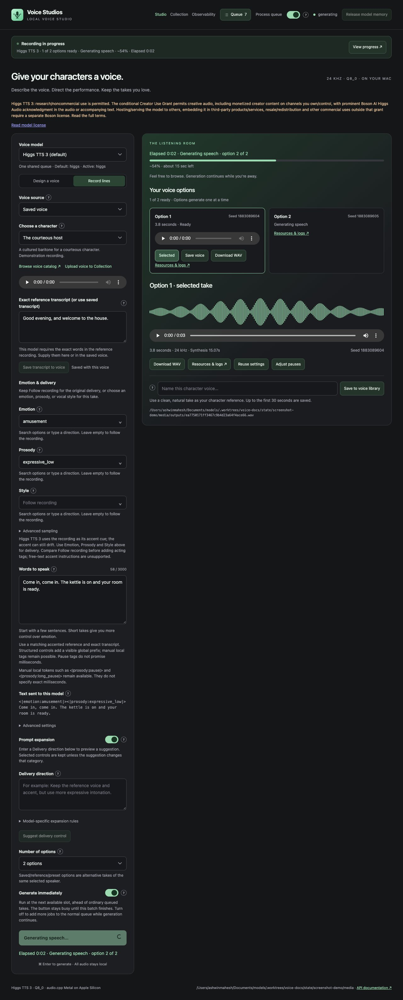
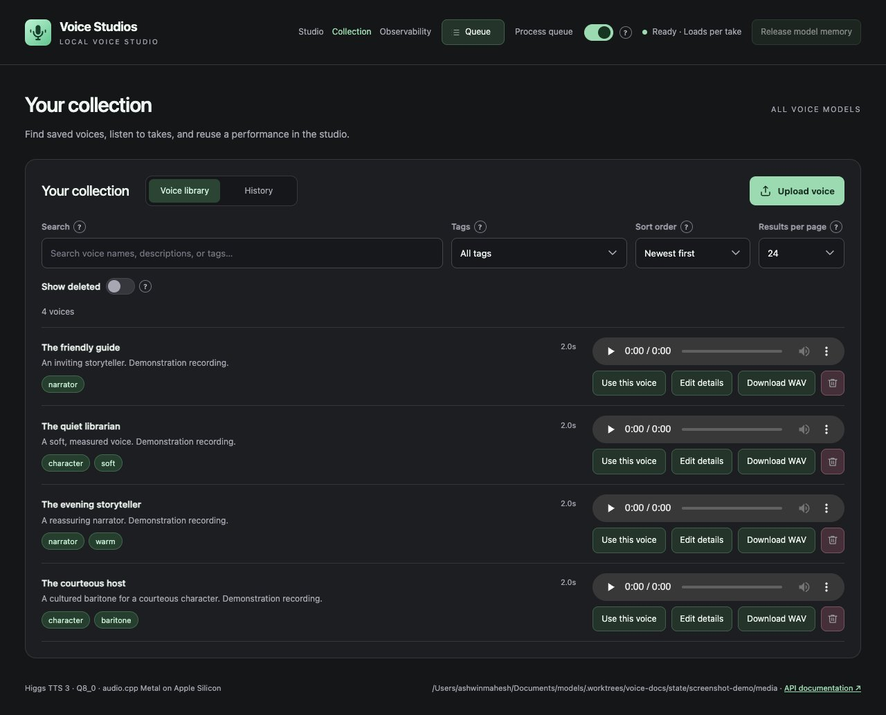
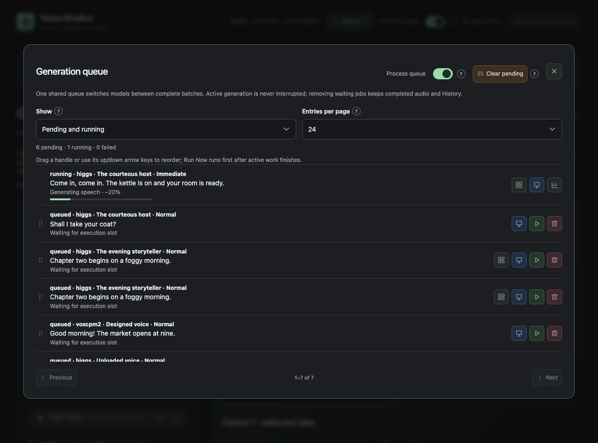
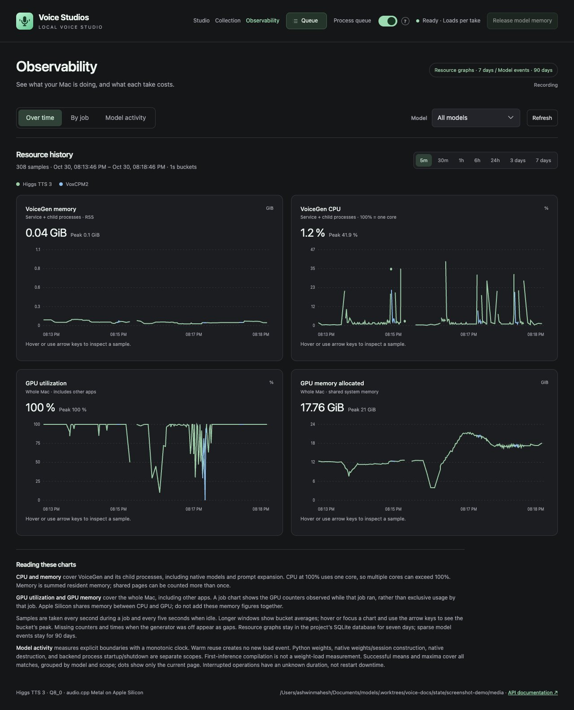
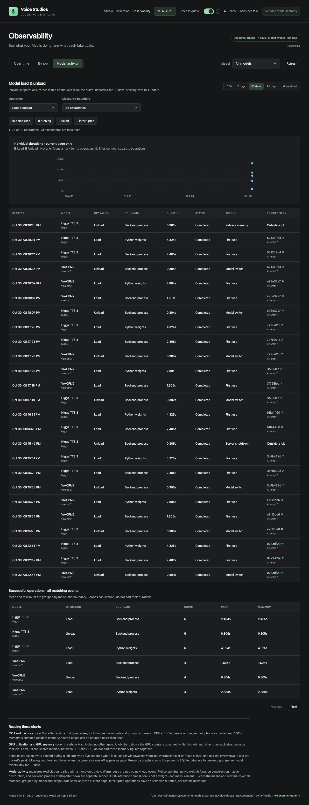

# VoiceGen Service

VoiceGen is a local voice studio for creating character voices and spoken dialogue on an Apple Silicon Mac. Describe a new voice or start with a recording, direct its performance, and compare takes before choosing one for your game or other project.

The studio supports **seven speech models**, with **Higgs TTS 3 as the default**. It includes a searchable voice Collection, audio downloads, and a saved queue so unfinished work can continue after a restart. You can use everything through the **Voice Studios** browser app or an API.

**[Follow the quick start](QUICKSTART.md)** for installation, your first recording, API examples, and settings. If you have already set up the project, run `make serve` and open **[localhost:5743](http://localhost:5743/)**.

## Inside the studio

Studio, Collection, and Observability share one header: navigation, **Queue**, a **Process queue** switch, the service status, and **Release model memory**, which is greyed out with a “No model loaded” tooltip when there is nothing to release. Click the Voice Studios name to return to Studio. Screenshots use benign demonstration records and fake inference; percentages and timings are not model benchmarks.

**Studio:** use **Design a voice** to create a character from a description, or **Record lines** to reuse a saved voice, an uploaded recording, or a built-in speaker. Enter the dialogue, direct the performance with the model's own controls, and generate 1–5 options to compare. While a take renders, the listening room shows an estimated percentage and time left, such as “~62% · about 1 min left”, based on how long recent takes of the same model took. A recording strip keeps that progress visible on other pages, and returning restores your batch and chosen option. [See the return flow](docs/recording-return-ux.md).

**Collection:** **Voice library** holds saved and uploaded voices with names, descriptions, and searchable tags; **History** holds generated takes, each labelled with the voice it used. Every entry is a row with its player and actions on one line. The trash icon deletes an entry after a [confirmation](docs/images/collection-delete-confirmation.jpg), and **Show deleted** lets you restore it within 24 hours; after that its files are removed. Uploaded voices are [transcribed locally](docs/transcription.md). See [retention and shared copies](docs/collection-retention.md).

**Queue:** each row shows its model, the voice (a saved voice's name, “Uploaded voice”, or “Designed voice”), and the running take's estimated progress. Row actions are icon buttons (Monitor, Run Now, Remove, and others) that name themselves on hover. Drag a row by its handle to reorder waiting jobs; it lifts while you drag. Like Image Studio, the window's header has a **Process queue** switch, an amber **Clear pending** button, and **×** to close. **Generate immediately**, on by default, runs your request right after the current take. Switching off **Process queue** holds ordinary waiting work; **Generate immediately** and **Run Now** jobs still run.

**Observability:** chart CPU, memory, and GPU use over windows from five minutes to seven days, filter by model, or inspect one job's resources and logs. GPU figures cover the whole Mac. **Model activity** keeps 90 days of model load and unload durations. [What the measurements mean](docs/observability.md).

Model load and unload history

Model files and recordings can live on an external SSD; source code, Python environments, and the shared SQLite queue stay in the project folder. Setup reuses a compatible installed Python or downloads one into the project, and is safe to rerun: verified downloads are reused. `make serve` never downloads anything and exits with setup instructions unless at least one model is ready. See [storage setup](QUICKSTART.md#1-install-and-set-up).

## Getting better voices and performances

VoiceGen brings several techniques into one place:

- **Start with the right recording.** For models that reuse a voice, a clear sample with the intended accent and delivery gives them a stronger starting point. Higgs and Fish also use the exact words spoken in that sample.
- **Use each model's acting controls.** These include delivery instructions, emotion recordings, expression settings, and supported performance tags. The studio shows the controls available for the selected model.
- **Refine written directions with a local LLM.** Prompt expansion can turn a voice description or acting direction into guidance suited to the chosen speech model. You can review the suggestion before applying it.
- **Compare options.** Generate 1–5 options at once, with two selected by default and a fresh random seed for every new Generate click. Voice-design models can explore contrasting descriptions; a saved or recorded voice produces alternative takes of the same speaker. Advanced settings also allow a fixed seed.
- **Adjust the pacing.** Supported models offer sentence and comma pause settings. You can also extend quiet gaps in a completed take and save the edit separately from the original.

More expression can change the voice or weaken an accent. Listen for all three—delivery, accent, and voice identity—when comparing takes. [Voice quality tips](VOICE_QUALITY.md) explain the recommended starting settings and model limitations.

## Local LLM for prompt expansion

The optional prompt expander uses **Qwen3.5-2B, a 4-bit local language model**. It helps write voice and performance directions; the selected speech model creates the audio. It is separate from the Qwen3-TTS speech model listed below.

`make setup` downloads or reuses the LLM along with your chosen speech model. `make serve` enables it by default. The UI's **Prompt expansion** switch lets you opt out for a request; start with `make serve NO_LLM=1` to disable it for the session.

Expansion follows different rules for each supported model and mode. The studio shows the original and expanded guidance. The LLM receives written voice and delivery directions, while dialogue, reference transcripts, and recordings stay out of its input. Suggestions still need listening checks; extra wording does not always produce a better performance.

Each model gets its own expansion rules: Vox Auto can preview an expanded Emotion & delivery direction, and Higgs uses **Suggest delivery control** to pick one supported Emotion, Prosody, or Style setting rather than writing prose. See [prompt expansion details](docs/voice-prompt-expansion.md).

## Speech models

| Model | Main use in this studio |
| --- | --- |
| **Higgs TTS 3 — default** | Recorded voices with exact transcripts, plus optional acting controls. |
| VoxCPM2 | Voice design, recorded voices, and recorded-performance reuse. |
| Qwen3-TTS | Voice design, recorded voices, or built-in speakers. |
| Chatterbox Original | Recorded voices with adjustable expression. |
| IndexTTS 2.5 | Recorded voices with emotion and timing controls. |
| MOSS VoiceGenerator | Voice design from descriptions. |
| Fish Audio S2 Pro | Recorded voices with exact transcripts and delivery tags. |

Startup chooses the saved default. The studio’s Voice model selector can use any set-up model for new requests. One generator switches models between jobs, and your Collection and queue are shared. Some features vary by model, and Chatterbox and IndexTTS are experimental on 24 GB Macs. See [model requirements and licenses](BACKENDS.md) before choosing one; the studio also displays relevant license notices.

## API overview

Available API endpoints

Here are the available endpoints. See [API.md](API.md) for request formats, examples, and errors. Both services also offer interactive documentation at `/docs` and the full schema at `/openapi.json` while running.

### Generator — localhost:5743

| Method | Endpoint | Purpose |
| --- | --- | --- |
| GET | `/health` | Check the generator and queue status. |
| GET | `/v1/models` | List set-up models and the saved default. |
| GET | `/api/capabilities?model=higgs` | See a model's features and controls. |
| GET | `/api/observability` | Chart resource history by time window and model. |
| GET | `/api/observability/models` | Inspect model load/unload durations and longer event history. |
| GET | `/api/observability/jobs` | List recorded job attempts and their resource peaks. |
| GET | `/api/observability/jobs/{id}` | Inspect resource charts for one job or attempt. |
| GET | `/api/jobs/{id}/logs` | Read available generation output for a job. |
| POST | `/api/generate` | Generate one take. |
| POST | `/api/candidates` | Generate 1–5 voice options. |
| GET | `/api/candidates/{id}` | Check a batch and its results. |
| POST | `/api/prompts/expand` | Preview expanded voice or delivery directions. |
| GET | `/api/queue` | List jobs across models. |
| GET | `/api/jobs/{id}` | Check a job and its result. |
| DELETE | `/api/queue/{id}` | Remove a waiting job. |
| DELETE | `/api/queue` | Clear waiting jobs. |
| POST | `/api/jobs/{id}/retry` | Retry a failed job. |
| POST | `/api/queue/{id}/move` | Move a waiting job up/down or beside another. |
| POST | `/api/queue/{id}/run-now` | Put a waiting job first. |
| GET | `/api/collection/cleanup` | Check 24-hour deleted-audio retention and cleanup status. |
| GET | `/api/history` | Browse generated takes. |
| GET | `/api/artifacts/{id}` | Get a take's details. |
| DELETE | `/api/artifacts/{id}` | Move a take to deleted items. |
| POST | `/api/artifacts/{id}/restore` | Restore a deleted take. |
| GET | `/api/metadata/{id}` | Download a take's saved metadata. |
| GET | `/api/audio/{kind}/{id}` | Play or download audio. |
| POST | `/api/artifacts/{id}/pauses` | Save a version with adjusted pauses. |
| GET | `/api/transcription` | Check local automatic transcription readiness and languages. |
| GET | `/api/voices` | Search the voice library. |
| GET | `/api/voices/{id}` | Get a saved voice. |
| POST | `/api/voices` | Save a voice to the library. |
| PATCH | `/api/voices/{id}` | Edit a voice's name, notes, tags, or transcript. |
| DELETE | `/api/voices/{id}` | Move a voice to deleted items. |
| POST | `/api/voices/{id}/restore` | Restore a deleted voice. |
| POST | `/api/voices/upload` | Upload a recording directly to the library. |
| GET | `/api/voice-tags` | List voice-library tags. |
| POST | `/api/references` | Upload a reference recording. |
| GET | `/api/references/{id}/original` | Download the original reference file. |
| POST | `/api/model/unload` | Release the model's memory. |

Both APIs also provide `POST /api/queue/pause` and `/api/queue/resume`, which the header's **Process queue** switch uses. Run Now waits for the active batch, then runs ahead of normal work.

### Queue service — localhost:55205

This service can accept jobs while the generator is off. Its queue endpoints use a different request format from the generator; see the [queue API guide](API.md#standalone-queue-api-port-55205).

| Method | Endpoint | Purpose |
| --- | --- | --- |
| GET | `/health` | Check the queue service. |
| GET | `/v1/models` | List set-up models and the saved default. |
| POST | `/api/queue` | Add a job. |
| GET | `/api/queue` | List jobs. |
| GET | `/api/queue/{id}` | Get a job's details and result. |
| PATCH | `/api/queue/{id}` | Update a waiting entry. |
| POST | `/api/queue/{id}/move` | Reorder a waiting entry. |
| POST | `/api/queue/{id}/run-now` | Put a waiting entry first. |
| DELETE | `/api/queue/{id}` | Remove a waiting entry. |
| DELETE | `/api/queue` | Clear waiting entries. |

## Guides

- [Quick start](QUICKSTART.md): setup, UI and API walkthroughs, settings, and stopping the services.
- [API guide](API.md): complete request formats and examples.
- [Model details](BACKENDS.md): requirements, downloads, features, and licenses.
- [Voice quality tips](VOICE_QUALITY.md): references, accents, expression, and pacing.
- [Prompt expansion details](docs/voice-prompt-expansion.md): model-specific rules and evaluation.
- [Resource history](docs/observability.md): resource charts, job attempts, and 90-day model load/unload history.

For development and automated operation, see [AGENTS.md](AGENTS.md) and the [service skill](skill/local-voice-studio/SKILL.md).
