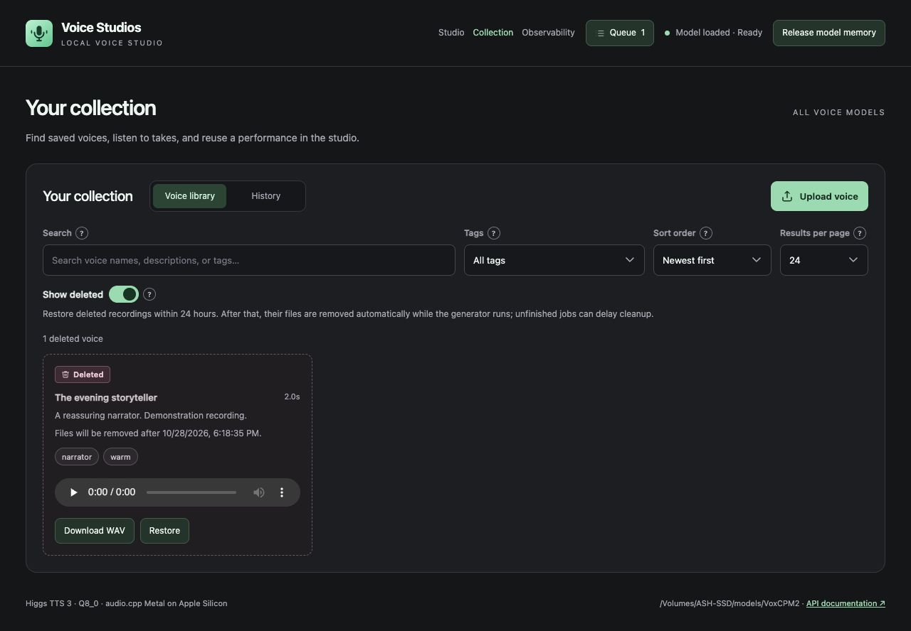

# Deleted recordings

Delete a voice or take from Collection and confirm its name. It is hidden from the active library immediately. Turn on **Show deleted** to listen, download or **Restore** it during the next **24 hours**.

Deleted voices and takes have a **Deleted** badge with a trash icon, a muted background and a dashed border. The removal deadline and Restore action remain readable.

The screenshot uses disposable demonstration audio and fake speech generation.

The first deletion starts the clock; deleting the same entry again does not extend it. The deleted card shows its removal deadline. After that deadline it can no longer be restored.

The generator removes expired files automatically at startup and checks again every minute while running. If it is off, cleanup happens the next time it starts. This is permanent file removal, not a move to the system Trash.

## Which files are removed?

- A take: its WAV, JSON metadata and catalog index, including files in a custom output folder.
- A saved voice: its WAV and JSON metadata. If it came from an upload, its normalized reference, reference metadata and original uploaded bytes are also removed when no other saved voice shares that upload.
- The completed deletion marker is removed after its files are gone.

Matching hidden macOS metadata companions on external drives are removed with their files.

Other voices and takes are independent copies. Deleting a generated take does not delete a voice you saved from it; deleting a voice does not delete its separate original take from History. Delete those Collection entries separately if you want their copies removed too. Unused temporary uploads that were never saved as voices are outside this Collection retention policy.

Queued or running jobs can delay removal of files they still need, including emotion references and jobs submitted through the independent queue API. Their deleted cards explain the delay. Cleanup checks again after those jobs finish or are removed. New generator requests cannot select a deleted voice.

Queue records, results and resource history remain as job history. Once the audio is removed, old audio/download URLs return 404. Cleanup does not replay generation.

## Storage or cleanup problems

If a volume is disconnected or files cannot be removed, cleanup reports the problem and retries. The deleted view shows the latest cleanup error. Cleanup plans survive partial removal or a restart. Restore is unavailable once cleanup has begun or the 24-hour window expires.

`GET /api/collection/cleanup` reports the retention window, check interval, worker state, last check/error and last sweep’s removed/deferred counts. It never starts cleanup itself. Deleted list entries expose `deletion.deleted_at`, `purge_after`, `cleanup_started` and `cleanup_deferred_reason`.

Existing deleted entries use their original deletion timestamps. Entries already older than 24 hours become eligible when this generator version next starts.
