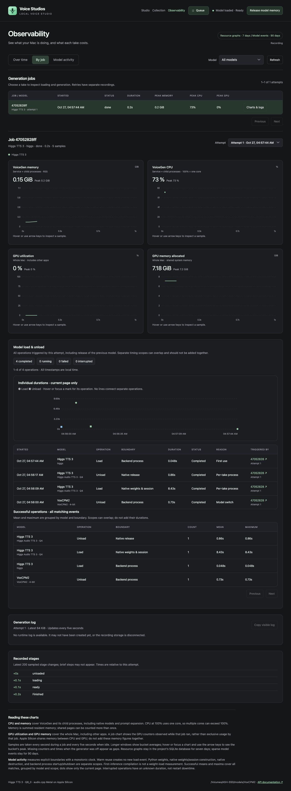

# Resource history

Open **Observability** in the studio header, or visit `http://localhost:5743/observability` while the generator is running. Recording starts automatically when the generator starts. You do not need to keep the page open.

**Over time** offers 5m, 30m, 1h, 6h, 24h, 3 days, and 7 days. Filter by the speech model used by each job. Model colors and hover details identify the model recorded with each point. **By job** lists recorded attempts with their status, duration, and resource peaks. Select **View charts** to see a whole attempt on a shorter elapsed-time axis. Choose another attempt to compare a retry. A Queue entry's **Resources** link opens the same view.

This screenshot uses demonstration data, not measured model performance.

## What is measured

| Metric | Scope and interpretation |
| --- | --- |
| VoiceGen memory | Sum of current resident memory (RSS) for the generator and its descendants, including native speech processes and the prompt LLM. Shared pages may be counted more than once. This is not a physical-memory footprint measurement. |
| VoiceGen CPU | Change in process CPU time divided by elapsed time across that process tree. 100% equals one core; multiple cores can exceed 100%. The first reading and intervals shorter than 250 ms have no CPU value. |
| GPU utilization | macOS driver utilization for the whole device, including other applications. It is not isolated to VoiceGen or a particular job. |
| GPU memory allocated | The driver's device-wide `Alloc system memory` counter. Apple Silicon uses shared memory; this is neither dedicated VRAM capacity nor a value to add to RSS. |
| GPU memory in use | The driver's `In use system memory` counter, also saved in the API. It is distinct from the allocated counter and can overlap process RSS. |

CPU and RSS come from `/bin/ps` using numeric process IDs, parent IDs, CPU time, RSS, and start time. Command lines and other processes' names are not saved. GPU counters come from `PerformanceStatistics` in `/usr/sbin/ioreg -a -r -d 1 -c IOAccelerator`. No administrator permissions, external service, or network access are needed. These driver fields can vary between macOS versions. If counters disappear or time out, their values remain unavailable rather than becoming zero.

The job’s speech backend and concrete model are recorded with each sample and attempt. During a prompt-expansion phase, the sample's model identifies `mlx-community/Qwen3.5-2B-4bit`, while its backend still identifies the selected speech model. Each point also records its phase. Job charts cover validation, expansion, model loading, generation, and final saving while the worker owns that attempt. Idle residency and standalone prompt previews are included in the overall timeline. A model that runs in a child process is included automatically through its parent relationship.

## Recording and storage

The generator records every second while a job is active and every five seconds while idle, plus start/end snapshots so short jobs still get a record. These are sampled measurements, not a guarantee of catching every instantaneous peak or CPU work from a child that exits between snapshots. Each system command has a 750 ms timeout. No inference imports or GPU synchronization are needed to gather metrics.

History uses three additional tables in the **existing** project database, `state/queue.sqlite3`: `resource_sessions`, `resource_runs`, and `resource_samples`. `QUEUE_DB` also isolates resource history during tests. There is no second database and nothing is written beside the model weights. Resource tables contain timestamps, numeric measurements, model IDs, job IDs, and status; they do not duplicate dialogue, prompts, transcripts, or audio.

Raw samples and completed attempts are retained for **seven days**. Cleanup runs about every five minutes while the generator runs and leaves all queue entries, outputs, and voice data untouched. SQLite can reuse freed pages; the database file need not shrink immediately. Recording stops when the generator stops. Restart gaps are visible, and attempts whose recorder ended unexpectedly are marked interrupted in resource history without changing their queue status. Pre-existing jobs do not acquire historical measurements retroactively.

Resource writes wait up to 200 ms for SQLite and then drop the sample, report the problem, and retry later. Monitoring failures do not fail or replay generation. The page displays collector errors, unavailable-counter notices, and the current session's dropped-sample count. The independent queue API does not collect metrics, load models, or serve this page. The generator reads history directly from SQLite, so an independent queue API outage does not affect it.

## API

| Request | Result |
| --- | --- |
| `GET /api/observability?window=30m&model=higgs` | Timeline, peaks, sampled model IDs, metric scopes, and collector status. Omit `model` for all speech backends. |
| `GET /api/observability/jobs?model=higgs&limit=25&offset=0` | Recorded attempts, newest first. Limits are 1–100. Includes IDs, attempt number, model, status, times, sample count, and peaks. |
| `GET /api/observability/jobs/JOB_ID` | Latest recorded attempt for that job, its charts, and up to 100 recorded attempts. |
| `GET /api/observability/jobs/JOB_ID?run_id=RUN_ID` | Select a particular recorded attempt belonging to that job. |

The `model` filter is the speech backend ID, such as `higgs` or `voxcpm2`. It includes prompt-expansion samples associated with that backend. Missing retained job history returns 404; invalid windows and pagination return 422. SQLite read failures return 503 and can be retried. Both APIs are documented through the generator's `/docs` and `/openapi.json`.

Times are Unix seconds in UTC; byte metrics are bytes. The UI displays memory in GiB. Each response includes `start`, `end`, `bucket_seconds`, `summary`, and `points`. `summary.samples` counts original snapshots; `peak_*` fields preserve their maxima. Points contain averages plus `peak_*` and sample counts for each time bucket, session, model, and phase. Responses target roughly 360 buckets and cap at 5,000 points with `truncated: true` when necessary. Gaps and missing values are not filled with zero. Hover or use a chart's arrow keys to compare bucket averages with their recorded peaks. Individual attempts stay separate after retries or restarts.
