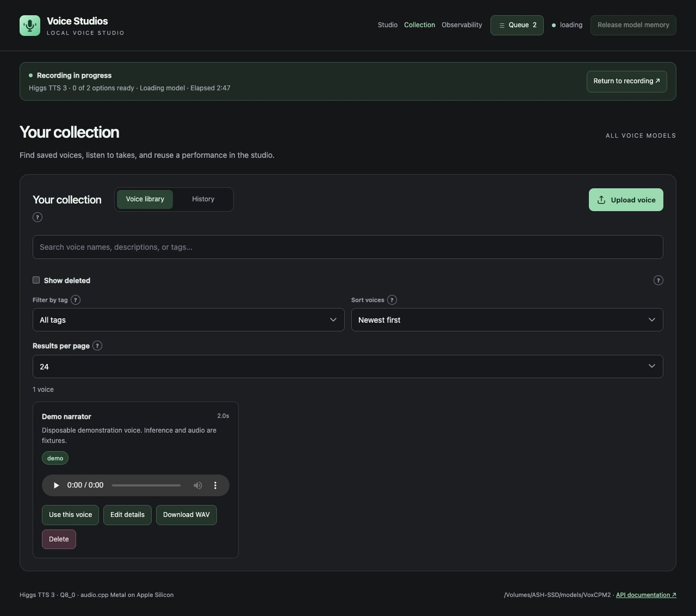
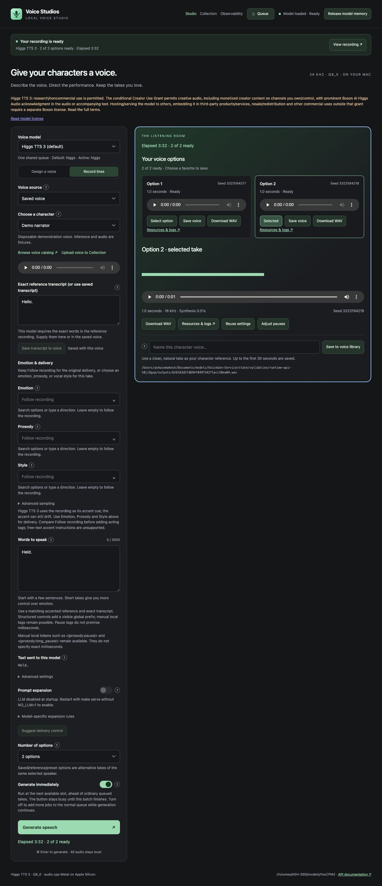

# Leaving and returning to a recording

The return flow was reviewed in desktop and 390-pixel phone layouts with held demo jobs, completed takes, reloads, navigation and interrupted API reads. Audio and displayed timing in these screenshots are fixtures.

| Finding | Change |
| --- | --- |
| Progress disappeared from view on Collection and Observability. | A compact recording strip stays visible and updates while browsing. |
| Finishing while away gave no clear next step. | The strip changes to **Your recording is ready** with **Listen to recording**. Partial and failed batches offer review instead. |
| Phone users returned to a long settings form above their audio. | Return links target the listening room and focus it after the form finishes restoring. |
| An ordinary return was labeled “Reconnecting.” | Opening and connection-loss states have separate wording. Genuine interruptions retry and offer **Reconnect now**. |
| A selected take relied on a thin outline. | Its button explicitly says **Selected**, with a pressed state for assistive technology. Selection survives another visit. |
| Returning browsers could mix cached scripts and new markup. | HTML, scripts and page styles share a content revision and revalidate. |
| Early interaction could race the restored form. | The form waits until restoration completes before accepting input. |

## Progress while browsing

## Restored recording

The review checked that interrupted reads do not create more jobs, elapsed time continues, recorded model and form choice remain separate, resource links return to the same batch, touch targets fit the phone width, and automatic recovery leaves no browser errors. Existing polling tests cover stale readers and retries; additional tests cover summary wording, partial results, private-content exclusion and shared UI revisions. The complete automated suite uses fake inference.
