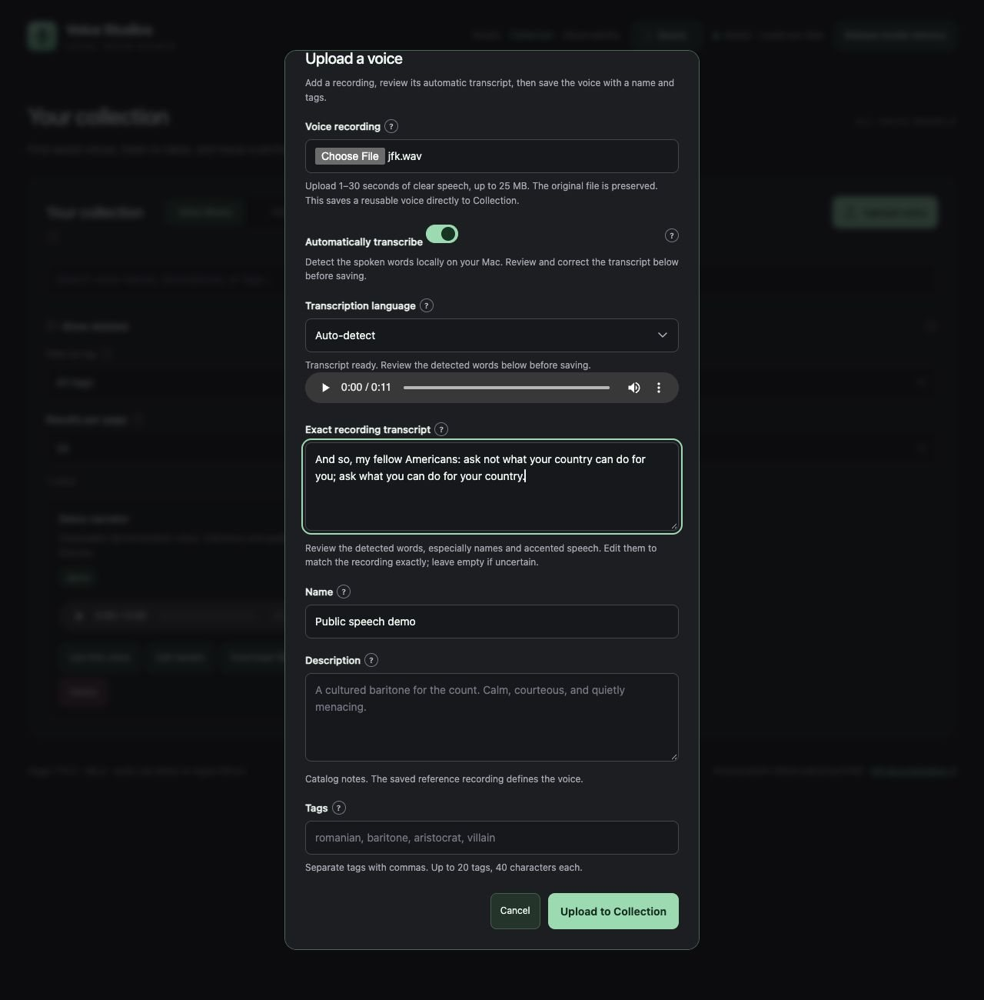

# Automatic transcripts for uploaded voices

Choose **Upload voice**, select a recording, and leave **Automatically transcribe** on. The studio recognizes the words locally, shows them beside a playback control, and lets you correct them before saving. Names and accented speech deserve a listening check. Typing while recognition runs keeps your edits; choosing another file or canceling prevents a late result from replacing them.



The screenshot uses the public speech sample included with whisper.cpp and a disposable Collection. Its transcript was edited before saving.

## Setup and storage

New `make setup` includes the transcriber. For an existing installation:

```sh
make setup-transcriber
make serve
```

This builds a pinned whisper.cpp CPU helper and downloads the roughly 57 MiB multilingual Whisper base Q5_1 model to the configured data folder's `transcription/` directory. On this installation that is the external SSD. Xcode command-line tools are needed for compilation on macOS. Existing CMake is reused, or pinned tooling is installed inside the project. Safe reruns verify and reuse the model and build. There are no downloads during serving.

The helper runs in a short-lived CPU process and releases its model when done, alongside whichever speech backend is selected. It does not reserve the GPU or add speech queue entries. One recording is transcribed at a time, with a 120-second limit. The service validates uploads to 1–30 seconds, at most 25 MiB, 8–96 kHz and mono/stereo before recognition. It preserves the original and uses a normalized 16 kHz mono copy. Scratch files are removed; completed preview references remain in reference storage if you cancel before saving.

On this Mac, the bundled approximately 11-second public sample took about 0.9 seconds with automatic language detection. A CLI run with English specified took about 0.33 seconds and peaked at 204 MiB resident memory. These are measurements of that sample on this machine, including CLI startup; recognition quality and time vary by recording.

## API

Check `GET /api/transcription` for availability, the model name and supported language codes. It checks local files without loading weights.

```sh
curl --fail-with-body --max-time 150 http://localhost:5743/api/voices/upload \
  -F 'file=@/absolute/path/voice.wav' \
  -F 'name=My character' \
  -F 'transcription_language=en'
```

The request waits for transcription and returns a saved voice with `transcript` and optional `transcription` metadata. A nonempty supplied `transcript` always wins and skips recognition. Set `transcribe=false` to skip it explicitly. The language controls recognition, not accent or translation; omission uses automatic detection.

To review before creating a voice, POST the file to `/api/references` with `transcribe=true`. Review its transcript and POST `/api/voices` with `reference_id`, a name and the corrected `transcript`. The UI uses this flow so the audio is uploaded once. Ordinary reference uploads keep their existing default of no recognition.

## If recognition fails

No new voice is created and the unsuccessful new reference is removed. Existing voices, recordings and queue entries remain available. The UI offers retry, manual text, or switching recognition off. Missing setup or runtime failure returns 503; another active transcription returns 409; a recognition timeout returns 504; invalid language or no recognized speech returns 422. Supplied/manual transcripts and opt-out uploads work without installed transcription assets. Review `API.md` for complete upload fields.
